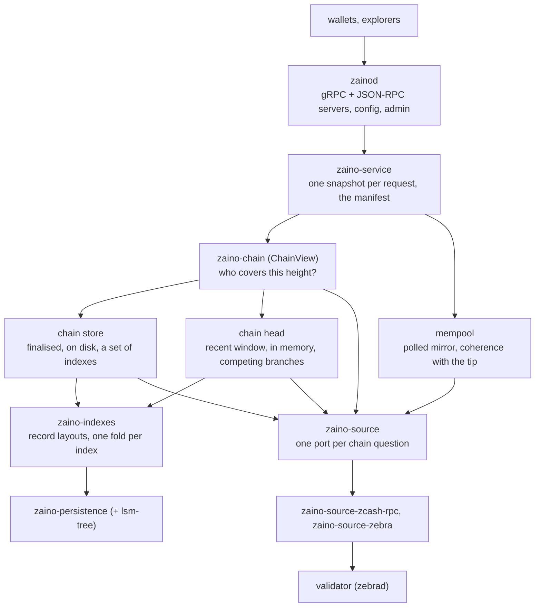

# Architecture

Zaino is an indexer for Zcash. It reads the chain from one validator, keeps
its own indexes of it, and serves light clients (the lightwalletd gRPC
protocol) and full clients (a subset of the zcash JSON-RPC) from those
indexes, asking the validator only for what it does not hold.

This page explains how the 27 workspace crates fit together. Each crate has
its own guide (`packages/<crate>/usage.md`, indexed from the
[README](../README.md#crate-usage-guides)); terms are in the
[glossary](./glossary.md).

## The layers

Everything above `zaino-source` is written against **ports**: one trait per
question a consumer can ask a validator ("the block at this height", "this
transaction"). Only `zainod` names an adapter. Zebra's crates and types are
linked only by the source adapters and the frozen `zaino-state`; a lint
(`makers lint-zebra-boundary`) enforces it.

## Where an answer comes from

Three providers cover the chain, each a range of heights:

| Provider | Covers | Holds |
| --- | --- | --- |
| chain store | genesis to its watermark | finalised history, durable, one chain |
| chain head | a window below the tip | recent blocks, in memory, with competing branches |
| validator | everything | the source of truth |

`zaino-chain`'s ChainView answers a read by asking who covers the height.
Where both tiers cover it the store wins. While the store is still building,
the range between it and the head's window is served by the validator: that
hole is the normal state during sync, and a read there is filled, never
refused. The seam between the tiers is
`zaino_consensus::MAX_NONFINALISED_DEPTH` (1,001) blocks below the tip.

`zaino-service` composes ChainView with the mempool and pins one chain state
per request (`Service::snapshot()`), so every read in a request sees the same
tip. Its manifest says, per capability, whether the answer is local, the
validator's, still building, or unavailable until an index is enabled.

Errors and inconsistencies are typed errors. Nothing is answered with an
empty or default value in place of data Zaino does not have.

## Indexes

The store is a configurable set of indexes (`[indexes]` in the config). Each
index is a record layout and one pure fold over blocks, defined once in
`zaino-indexes` and run by both tiers: the store folds finalised blocks to
disk, and the head runs the same fold over its window, so both answer the
same reads.

| Set | Serves locally |
| --- | --- |
| `lightclient` | compact blocks, headers, treestates, subtree roots |
| `zcash_rpc` | the JSON-RPC reads: spends, address history, the txout set, treestates; no compact blocks |
| `full` | every index, including the ZIP 221 history tree |
| `empty` | nothing: every read is the validator's |

Persistence is behind ports too (`zaino-persistence`); the on-disk backend is
`zaino-persistence-lsm-tree`.

## The mempool

`zaino-mempool-service` mirrors the validator's mempool by polling. Its core
set is tip-agnostic; a coherence layer pairs it with the chain tip Zaino
serves, so a reader never sees a mempool for one tip against a chain at
another.

## The crates

| Layer | Crates |
| --- | --- |
| Daemon | `zainod` (binary and `zainodlib`) |
| Service | `zaino-service` |
| Chain | `zaino-chain`, `zaino-chain-store` and `-service`, `zaino-chain-head` and `-service`, `zaino-indexes` |
| Mempool | `zaino-mempool`, `zaino-mempool-service` |
| Source | `zaino-source`, `zaino-source-macros`, `zaino-rpc`, `zaino-source-zcash-rpc`, `zaino-source-zebra`, `zaino-source-mock` |
| Persistence | `zaino-persistence`, `zaino-persistence-lsm-tree` |
| Foundation | `zaino-primitives`, `zaino-encoding`, `zaino-proto`, `zaino-address`, `zaino-consensus`, `zaino-component`, `zaino-async`, `zaino-logging` |
| Legacy | `zaino-state`: the pre-v2 library surface, kept as a thin shim over `zaino-service` |

A `-service` crate is the runtime of the subsystem whose vocabulary and ports
its sibling defines. `zaino-source-mock` is the one fake validator every
crate's unit tests share.

## Tests

Unit tests run against `zaino-source-mock` and need nothing else. The live
suite (`live-tests/`, a separate workspace) drives a real `zebrad` and
compares Zaino's answers with the validator's. See [testing](./testing.md).
